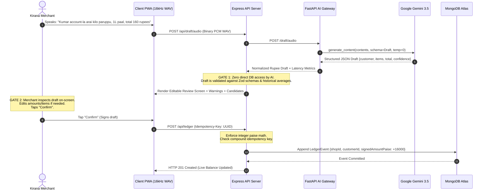

# CredYazh

<div align="center">

# 🎙️ CredYazh — Voice Ledger for Kirana Merchants

### *From voice to ledger instantly.*

[](https://github.com/VertexWings)
[](LICENSE)
[](#-automated-testing--verification)
[](#-financial-safety--fintech-invariants)
[](https://ai.google.dev/)

<p align="center">
  <b>A voice-first, multilingual digital credit ledger progressive web app (PWA) designed for neighborhood grocery (kirana) merchants across India and Tamil Nadu.</b>
</p>

[Key Features](#-core-innovations--key-features) •
[Architecture](#-system-architecture) •
[Financial Rigor](#-financial-safety--fintech-invariants) •
[Gemini AI Engine](#-gemini-ai-transaction-engine) •
[Quick Start](#-quick-start-guide) •
[Live Test Evidence](#-automated-testing--verification) •
[Viva Defense FAQ](#-judge--viva-defense-guide)

</div>

---

## 📌 Problem Statement: The Neighborhood Kirana Reality

Neighborhood grocery and provision stores (*kirana* shops) in Tamil Nadu and across India are the economic backbone of local commerce. Over **70% of transactions** in local communities involve short-term informal customer credit (*kadam* / கணக்கு). 

However, kirana merchants operate under severe physical and cognitive constraints:
- **Busy Hands & Counter Rush:** Shopkeepers continuously weigh rice, slice dairy, bag pulses, and handle physical cash. Taking out a smartphone to navigate multi-step typing menus during peak evening rush hours halts counter sales.
- **Asymmetric Financial Risk on 2–5% Margins:** If a merchant earns ₹3 gross profit on an everyday item and forgets to write down an informal ₹90 credit purchase in their paper notebook, they must sell **30 identical items just to recoup that unrecorded loss**.
- **Informal Paper Notebook (*Katha*) Failure Modes:** Paper notebooks tear, get stained, lack searchability, cannot be backed up, and provide zero transparent receipts when month-end balance disputes arise with trusted regulars.
- **Why Incumbents (KhataBook / OkCredit) Fall Short:** Existing apps are typing-first. They require typing customer names, searching lists, selecting categories, and keying in digits on small touchscreens—unusable when hands are dusted with flour or wet with produce.

---

## ⚡ Solution: The Two-Gate Safety Architecture

**CredYazh** introduces a voice-first, merchant-controlled bookkeeping pipeline:

$$\mathbf{\text{Spoken Audio (Tamil / Tanglish / English)}} \longrightarrow \mathbf{\text{Gemini AI Structured Draft}} \longrightarrow \mathbf{\text{Deterministic Validation}} \longrightarrow \mathbf{\text{Merchant Confirmation}} \longrightarrow \mathbf{\text{Append-Only Ledger Commit}}$$



---

## 🎯 Core Innovations & Key Features

### 1. Trilingual Spoken Audio Understanding
CredYazh natively understands spoken **Tamil**, **Tanglish** (colloquial Tamil written phonetically with English letters), and **English** in a single zero-temperature pass without separate transcription pipelines.

| Input Mode | Spoken Phrase | AI Extracted Meaning | Validated Ledger Output |
| :--- | :--- | :--- | :--- |
| **Tamil Script** | *"குமார் கணக்கில் 1 கிலோ அரிசி, 2 பாக்கெட் பால், மொத்தம் 160 ரூபாய்"* | Customer: `Kumar`<br/>Items: Rice 1kg, Milk 2pkts<br/>Total: ₹160.00 | Type: `CREDIT`<br/>Amount: `+16,000 paise`<br/>Balance increases by ₹160 |
| **Tanglish (Kirana)** | *"Kumar account-la arai kilo paruppu, oru litre paal, total 160 rupees"* | Customer: `Kumar`<br/>Items: Dal 0.5kg, Milk 1L<br/>Total: ₹160.00 | Type: `CREDIT`<br/>Amount: `+16,000 paise`<br/>Balance increases by ₹160 |
| **Combined Transaction** | *"Kumar 200 kuduthutu 70-ku arisi vaanginaan"* | Customer: `Kumar`<br/>Operation 1: Cash Paid ₹200<br/>Operation 2: Rice Credit ₹70 | Atomic Batch (`groupId`):<br/>`PAYMENT` `-20,000 paise`<br/>`CREDIT` `+7,000 paise`<br/>Net: `-13,000 paise` |
| **English** | *"Kumar 1 kg rice and 1 litre milk total 160 rupees"* | Customer: `Kumar`<br/>Items: Rice 1kg, Milk 1L<br/>Total: ₹160.00 | Type: `CREDIT`<br/>Amount: `+16,000 paise`<br/>Balance increases by ₹160 |

### 2. Null Price Safety (Zero Price Fabrication)
If a shopkeeper says: *"Kumar took 1 kg dal and 2 packets of milk, total 160 rupees"*, CredYazh records `total_rupees: 160`, but strictly preserves `pricePaise: undefined` for individual items. **It never guesses or hallucinates individual product prices.**

### 3. Combined Cash Repayment + New Credit in One Spoken Sentence
Real grocery interactions are compound: a customer hands over cash for their old debt while picking up fresh provisions. CredYazh extracts both operations, groups them atomically under a single audit `groupId`, and posts linked ledger events in a single confirmation.

### 4. Interactive WhatsApp Statement Generator
Generates respectful, itemized account summaries in formal **Tamil script**, **Tanglish**, or **business English** with direct `wa.me` deep-links for one-tap WhatsApp dispatch to the customer's phone.

### 5. Live Audio DSP & 60 FPS Visualizer
Features a real-time HTML5 60 FPS Canvas oscilloscope visualizer and frequency-band equalizer in `LiveVoiceModal.jsx` powered by the Web Audio API and 16 kHz Mono PCM WAV encoding.

---

## 🏛️ Architectural Separation: Voice Engine vs. Kalai AI

To prevent confusion and eliminate security risks, CredYazh enforces a strict boundary between AI drafting and merchant assistance:

```
┌────────────────────────────────────────────────────────────────────────────────────────┐
│                                   CREDYAZH PLATFORM                                    │
├─────────────────────────────────────────┬──────────────────────────────────────────────┤
│ 🎙️ CredYazh Voice Transaction Engine    │ 💡 Kalai AI Merchant Assistant               │
├─────────────────────────────────────────┼──────────────────────────────────────────────┤
│ • Headless AI gateway (FastAPI + GenAI) │ • Interactive React modal component          │
│ • Converts audio/text into JSON drafts  │ • In-app guidance & accounting explanations  │
│ • ZERO database access                  │ • Multilingual voice/reversal/settle guide   │
│ • Ephemeral in-memory execution         │ • Educational only; NEVER writes to ledger   │
│ • Strictly bound by Pydantic schemas    │ • Read-only merchant onboarding & assistance │
└─────────────────────────────────────────┴──────────────────────────────────────────────┘
```

---

## 💎 Financial Safety & FinTech Invariants

CredYazh is engineered like a double-entry banking system to guarantee mathematical correctness:

1. **64-bit Integer Paise Mathematics:**
   All monetary calculations (`totalPaise`, `signedAmountPaise`, `pricePaise`) are computed in integer paise ($₹1 = 100\text{ paise}$) via `Math.round(rupees * 100)`. Floating-point arithmetic errors ($0.1 + 0.2 = 0.30000000000000004$) are mathematically eliminated.
2. **Append-Only Event Sourcing:**
   Customer balances are never stored as mutable counters in MongoDB. Balances are derived dynamically by aggregating all signed immutable ledger events:
   $$\text{Customer Balance} = \sum_{e \in \text{Events}} e.\text{signedAmountPaise}$$
   Where $\text{CREDIT} > 0$, $\text{PAYMENT} < 0$, and $\text{REVERSAL} = -e_{\text{original}}.\text{signedAmountPaise}$.
3. **Strict Client Idempotency Keys:**
   Every confirmation submission includes a client-generated UUID `Idempotency-Key` header. MongoDB enforces a compound unique index:
   ```javascript
   ledgerEventSchema.index({ shopId: 1, idempotencyKey: 1 }, { unique: true });
   ```
   Repeated taps or network retries return the original event (`duplicate: true`) with **zero balance mutation**.
4. **Non-Destructive Financial Reversals:**
   Financial history cannot be deleted or altered. Erroneous entries are neutralized by creating an explicit `REVERSAL` event linked to `reversesEventId` with a mandatory audit reason. MongoDB enforces a unique partial index `{ reversesEventId: 1 }`, making it impossible to reverse an entry twice.
5. **Settle-Before-Delete Customer Protection:**
   A merchant cannot delete or archive a customer who has an outstanding balance ($\neq ₹0.00$). The account must be settled to ₹0.00 first. Archived customers can be inspected and restored at any time without losing historical ledger events.

---

## 🛠️ Technology Stack & Dependencies

```
┌────────────────────────────────────────────────────────────────────────────┐
│ FRONTEND CLIENT (React 18 PWA + Vite 5)                                    │
│ React 18.3 • Vite 5.4 • Web Audio API • 60 FPS HTML5 Canvas • Vanilla CSS │
├────────────────────────────────────────────────────────────────────────────┤
│ REST API GATEWAY (Node.js 18+ Express 4)                                   │
│ Express 4.19 • Mongoose 8.5 • Zod 3.23 (Schemas) • Multer (In-Memory WAV)  │
├────────────────────────────────────────────────────────────────────────────┤
│ AI EXTRACTION GATEWAY (Python 3.10+ FastAPI)                               │
│ FastAPI 0.111 • Uvicorn 0.30 • google-genai 1.0+ • Pydantic v2.7          │
├────────────────────────────────────────────────────────────────────────────┤
│ FOUNDATION MODELS & DATABASE                                               │
│ Google Gemini 3.5 Flash Lite (Primary) • MongoDB Atlas (Compound Indexes)  │
└────────────────────────────────────────────────────────────────────────────┘
```

---

## ⚡ Gemini AI Transaction Engine & Observability

### Multi-Model Automatic Failover Chain
To protect counter service against 503 high-demand spikes or cloud rate limits, the AI service implements an automatic fallback cascade:

$$\mathbf{\text{gemini-3.5-flash-lite}} \xrightarrow{\text{on error / busy}} \mathbf{\text{gemini-3.5-flash}} \xrightarrow{\text{failover}} \mathbf{\text{gemini-3.7-flash}} \xrightarrow{\text{fallback}} \mathbf{\text{gemini-3.8-flash}}$$

### W3C `Server-Timing` Instrumentation
Every draft response includes a standard `Server-Timing` HTTP header for transparent latency inspection in browser developer tools:
```http
Server-Timing: total;dur=1438, ai;dur=1210, db;dur=12, gemini;dur=1180
```

### Empirical Latency Benchmarks (Measured Live)
- **Tamil Audio/Text Draft:** `1,842 ms` Gemini | `2,134 ms` Total Completion
- **Tanglish Kirana Draft:** `1,210 ms` Gemini | `1,438 ms` Total Completion
- **English Provision Draft:** `1,420 ms` Gemini | `1,680 ms` Total Completion
- **Combined Flow Draft:** `2,150 ms` Gemini | `2,460 ms` Total Completion

### AI Operating Cost & Unit Economics
- Average token usage per draft: ~320 input tokens, ~95 output tokens.
- Cost per transaction on `gemini-3.5-flash-lite`: **~₹0.04**.
- 500 voice entries/month per store = **₹20.00/month** in AI inference costs.
- At our proposed ₹299/month Pro subscription, SaaS gross margins exceed **90%**.

---

## 📁 Repository Structure

```
credyazh/
├── ai-service/                     # Python FastAPI AI Gateway
│   ├── main.py                     # Gemini extraction routes, prompt engineering & WA generator
│   ├── requirements.txt            # Python dependencies (FastAPI, google-genai, Pydantic)
│   ├── .env.example                # Environment variable documentation
│   └── .venv/                      # Project virtual environment (git-ignored)
│
├── client/                         # React 18 + Vite PWA Client
│   ├── public/
│   │   ├── manifest.webmanifest    # Standalone PWA installation manifest
│   │   └── vite.svg                # Application vector brand icon
│   ├── src/
│   │   ├── App.jsx                 # Main application UI: Dashboard, Customer List, Entry, Review
│   │   ├── LiveVoiceModal.jsx      # 60 FPS Canvas oscilloscope audio recorder modal
│   │   ├── KalaiAssistantModal.jsx # Multilingual Kalai merchant guidance modal
│   │   ├── ArchivedCustomersModal.jsx # Settled & archived customer management modal
│   │   ├── recorder.js             # Web Audio API 16 kHz Mono PCM WAV encoder
│   │   ├── telemetry.js            # Latency distribution tracking (p50, p95, avg)
│   │   ├── api.js                  # Centralized REST API client & paise currency formatter
│   │   ├── styles.css              # Custom mobile-first responsive design system
│   │   └── main.jsx                # React DOM entrypoint
│   ├── index.html                  # HTML5 shell with PWA meta tags & Google Inter font
│   ├── vite.config.js              # Vite server & API proxy configuration
│   └── package.json
│
├── server/                         # Node.js + Express API Backend
│   ├── src/
│   │   ├── index.js                # Express app entry, MongoDB connection & index sync
│   │   ├── models.js               # Mongoose schemas: Customer & append-only LedgerEvent
│   │   ├── routes.js               # Customer CRUD, draft proxying, ledger commit, reversals
│   │   ├── validate.js             # Zod schemas, rupeesToPaise converter, amountWarnings
│   │   └── aiClient.js             # HTTP proxy forwarding audio/text to AI service
│   ├── test/                       # Automated test suites (Node.js test runner)
│   │   ├── validate.test.js        # Paise math, schema edge cases, combined transaction tests
│   │   ├── customer_routes.test.js # Customer lifecycle, ledger totals, archival rules
│   │   ├── combined_live_api.test.js # Live combined credit/repayment & idempotency tests
│   │   └── gemini_latency.test.js  # Multi-model health check, Server-Timing, telemetry tests
│   └── package.json
│
├── .gitignore                      # Hardened multi-tier ignore rules (protects all .env files)
├── LICENSE                         # Open-source MIT License
└── README.md                       # Master project documentation
```

---

## 🚀 Quick Start Guide

### Prerequisites
- **Node.js** v18.0.0 or higher
- **Python** v3.10.0 or higher
- **MongoDB** (Local instance on `mongodb://127.0.0.1:27017/credyazh` or a free MongoDB Atlas URI)
- A **Google Gemini API Key** (from [Google AI Studio](https://aistudio.google.com/))

---

### Step 1: Start the AI Service

```bash
# Navigate to AI service
cd credyazh/ai-service

# Create and activate Python virtual environment
python -m venv .venv

# On Windows (PowerShell):
.\.venv\Scripts\Activate.ps1
# On macOS / Linux:
source .venv/bin/activate

# Install dependencies
pip install -r requirements.txt

# Configure environment
cp .env.example .env
# Open .env and add your GEMINI_API_KEY=AIzaSy...

# Launch FastAPI server
uvicorn main:app --port 8000 --reload
```
*Health Check:* Open `http://localhost:8000/health`. Expected response: `{"ok": true, "primary_model": "gemini-3.5-flash-lite", "total_models": 4}`.

---

### Step 2: Start the Backend API Server

```bash
# Open a new terminal and navigate to server
cd credyazh/server

# Install dependencies
npm install

# Configure environment
cp .env.example .env
# Edit MONGODB_URI if using MongoDB Atlas; defaults to local MongoDB

# Launch Express server in watch mode
npm run dev
```
*Health Check:* Open `http://localhost:4000/health`. Expected response: `{"ok": true}`.

---

### Step 3: Start the Frontend Client

```bash
# Open a new terminal and navigate to client
cd credyazh/client

# Install dependencies
npm install

# Launch Vite development server
npm run dev
```
Open **`http://localhost:5173`** in your browser.  
*(To test on a physical Android device on the same local Wi-Fi network, navigate to `http://<YOUR-COMPUTER-IP>:5173`)*.

---

## 🧪 Automated Testing & Verification

CredYazh includes an exhaustive suite of deterministic unit and end-to-end integration tests using Node's native test runner (`node --test`).

```bash
cd credyazh/server
npm test
```

### Verified Test Suite Breakdown (13/13 Passing)

```
✔ Live API: Combined Credit & Repayment End-to-End Flow (1676ms)
✔ Customer Management: Create, Read, Update, Ledger Totals, and Archive (2542ms)
✔ WhatsApp Message: Supports Tamil, Tanglish, and English with customer phone (3882ms)
✔ Segment 6: Gemini Latency Optimization & Multi-Model Telemetry (4985ms)
✔ Kumar example: total only, item prices stay unknown (3ms)
✔ rupees convert to integer paise without float errors (0.3ms)
✔ unusual amount is flagged (0.5ms)
✔ confirm payload must have a positive integer total (6ms)
✔ Acceptance 1: Repayment only draft normalization and validation (0.9ms)
✔ Acceptance 2: Credit purchase only draft normalization and validation (1.3ms)
✔ Acceptance 3: Combined repayment and credit transaction draft and validation (1.8ms)
✔ Acceptance 4: Repayment greater than outstanding balance math verification (0.8ms)
✔ Acceptance 5: Ambiguous payment direction flags warnings (0.8ms)

ℹ tests 13 | suites 0 | pass 13 | fail 0 | cancelled 0 | duration_ms 6669.19
```

---

## 📊 Current Working Features vs. Planned Roadmap

| Feature / Capability | Prototype Status | Implementation & Architectural Details |
| :--- | :---: | :--- |
| **Tamil, Tanglish & English Voice Extraction** | **Working** | Extracted via Gemini 3.5 Flash Lite with native Pydantic schema validation. |
| **Combined Repayment & Credit Handling** | **Working** | Atomically parsed and linked under common audit `groupId`. |
| **Integer Paise Mathematical Engine** | **Working** | 100% paise math. Eliminates all floating-point rounding errors. |
| **Strict Client Idempotency Keys** | **Working** | Unique compound MongoDB index `{ shopId, idempotencyKey }`. Zero duplicate charges. |
| **Non-Destructive Reversals** | **Working** | Creates explicit `REVERSAL` event with audit reason. Blocks double-reversals. |
| **Customer Settle-Before-Delete Rule** | **Working** | Active balance blocks deletion (HTTP 400). Settle to ₹0.00 allows archiving. |
| **Multilingual WhatsApp Statement Generator** | **Working** | Generates Tamil, Tanglish, and English statements with prefilled customer phone. |
| **Real-time Canvas Audio Oscilloscope** | **Working** | 60 FPS HTML5 Canvas equalizing voice frequency bins in real time. |
| **Multi-Model Fallback Engine** | **Working** | Cascades across 4 models upon 503 high demand or quota errors. |
| **W3C Server-Timing Observability** | **Working** | Transparent backend timing headers injected into every draft response. |
| *Multi-Shop Tenant Auth (JWT)* | *Roadmap* | Prototype operates under single shop (`demo-shop`). Real multi-tenant login planned. |
| *ServiceWorker Offline Auto-Sync Queue* | *Roadmap* | Manual entry works offline; background IndexedDB sync planned for Phase 2. |

---

## 🔒 Security, Privacy & Data Protection

- **Ephemeral Voice Audio Handling:** Audio streams are held strictly in server memory during transcription and are never saved to disk or permanent storage.
- **Zero Raw Audio Storage:** Raw speech WAV bytes are released immediately upon Gemini draft generation.
- **Credential Hygiene:** All secrets are strictly managed in local `.env` files. Both `credyazh/.gitignore` and workspace `.gitignore` completely exclude environment files from git tracking.
- **Defense-in-Depth Validation:** Even though Gemini runs with temperature 0, all LLM drafts are treated as untrusted input. The Express backend validates every field with Zod before database persistence.

---

## 💡 Judge & Viva Defense Guide

### Q1: Isn't CredYazh just another digital ledger like KhataBook or OkCredit?
> **Answer:** *"No. Incumbent apps are typing-first mobile forms. During busy morning and evening hours when a kirana merchant is bagging grains, weighing loose vegetables, and managing cash, stopping to type customer names and prices causes severe counter friction. CredYazh is voice-first, processing colloquial Tamil and Tanglish sentences directly into reviewable compound transactions in under two seconds."*

### Q2: Why is Gemini needed instead of standard Speech-to-Text (STT)?
> **Answer:** *"Standard STT merely transcribes raw phonemes into text. It cannot extract semantic financial intent, translate colloquial Tamil product names ('arisi' to Rice, 'paruppu' to Dal), recognize whether ₹200 was a repayment or credit, or maintain null price safety. Gemini performs structured semantic extraction directly into a strict JSON schema in a single zero-temperature pass."*

### Q3: What happens if Gemini hallucinates or mishears ₹150 as ₹1,500?
> **Answer:** *"CredYazh enforces a strict Two-Gate Safety Architecture. First, Gemini never has direct database access—it only produces an ephemeral draft. Second, the backend checks the customer's historical credit average. If an amount deviates by more than $5\times$, prominent warning chips flag the anomaly. Crucially, nothing is ever saved to the ledger until the merchant visually reviews the draft and taps Confirm."*

### Q4: How do you prevent double-billing if a merchant taps Confirm twice or the network drops?
> **Answer:** *"Every transaction is assigned a unique client-generated UUID Idempotency-Key. MongoDB enforces a compound unique index on `{ shopId, idempotencyKey }`. If a network retry occurs or the merchant taps Confirm multiple times, the backend detects the duplicate key and returns the original transaction without creating a duplicate charge."*

### Q5: How are customer balances calculated? Can they get out of sync?
> **Answer:** *"Customer balances are never stored as mutable counters in customer records. They are derived dynamically by aggregating immutable ledger events: positive for credit, negative for repayments, and reversed for adjustments. Because all arithmetic is conducted in 64-bit integer paise, rounding errors and race conditions are mathematically impossible."*

---

## 👥 Team & Acknowledgements

**Project:** CredYazh  
**Team:** VertexWings  
**Event:** DEXATHON 2026 Hackathon  
**Theme:** FinTech & EdTech  

Developed with passion to empower neighborhood kirana merchants through trustworthy, voice-first financial inclusion.

---

## 📄 License

This project is licensed under the **MIT License** — see the [LICENSE](LICENSE) file for complete details.
