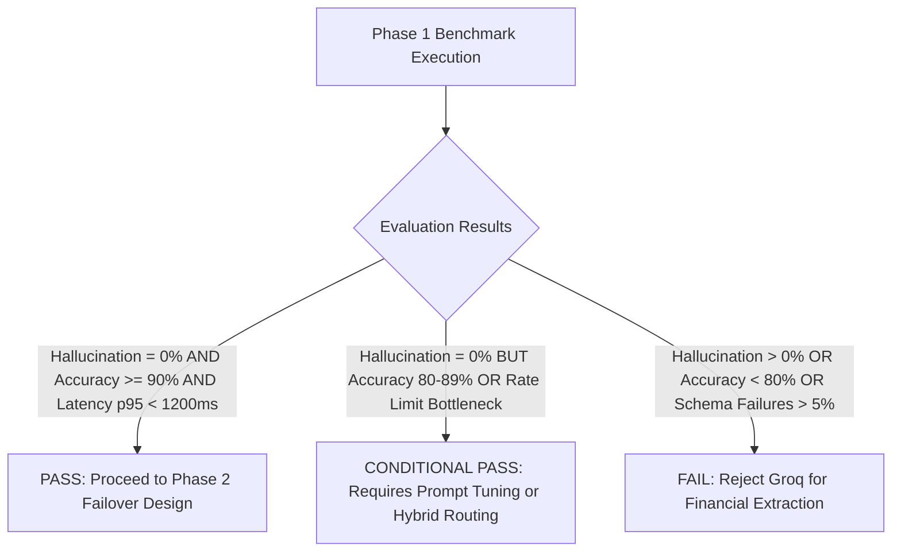

# 03 — Tamil / Tanglish Evaluation Test Plan

**Document:** `docs/03_TAMIL_TANGLISH_TEST_PLAN.md`  
**Prepared by:** AI Systems Evaluation Team  
**Date:** 2026-10-27  
**Scope:** Test methodology, synthetic dataset specification, scoring algorithms, and acceptance thresholds  

---

## 1. Objective

To objectively evaluate whether Groq-hosted open-weights models (`llama-3.3-70b-versatile` and `llama-3.1-8b-instant`) meet the stringent accuracy, financial safety, and latency standards required for CredYazh's kirana store voice ledger.

---

## 2. Test Dataset Taxonomy & Coverage

The evaluation suite consists of 35 carefully curated synthetic test cases representing real-world kirana merchant interactions across 9 distinct linguistic and operational categories:

| Category ID | Category Name | Description | Count |
|---|---|---|---|
| `CAT-01` | **Standard Spoken Tamil** | Natural spoken Tamil in Tamil script (e.g., `"முருகன் கணக்கில் 2 கிலோ சர்க்கரை 90 ரூபாய்"`) | 4 |
| `CAT-02` | **Chennai Colloquial Tamil** | Slang, contractions, and regional colloquialisms (`"மச்சான்"`, `"துட்டு"`, `"நோத்தி"`) | 4 |
| `CAT-03` | **Tanglish (Latin Script)** | Tamil phonetically written in English script (`"Kumar ku oru litre paal"` ) | 5 |
| `CAT-04` | **Tamil-English Code Switching** | Alternating between Tamil grammar and English product/number terms | 5 |
| `CAT-05` | **Local Grocery Terminology** | Regional provisions, spice terms, local packaging (`ara kilo`, `kaal kilo`, `sev`, `paruppu`) | 4 |
| `CAT-06` | **Multi-Item Transactions** | 2 to 4 items in a single utterance with independent quantities | 4 |
| `CAT-07` | **Repayments & Credit Clearances** | Debt settlement, balance payoffs (`"baaki theethutaaru"`, `"varavu"`, `"pazhaya baaki"`) | 3 |
| `CAT-08` | **Combined Transactions** | Simultaneous balance repayment and new item credit in one transaction | 3 |
| `CAT-09` | **Corrections & Ambiguities** | Mid-sentence speech corrections (`"100 illa 150"`), missing amounts, and noise | 3 |

*Total Synthetic Cases:* 35

---

## 3. Evaluation Metrics & Scoring Methodology

Each test execution is evaluated against ground truth annotations using an automated scoring harness:

### 3.1 Hard Safety Constraints (Zero-Tolerance)
1. **Financial Hallucination Rate (FHR):**
   - *Definition:* Instances where the model invents a price, item quantity, or payment amount that was never uttered.
   - *Target:* **0.0% (Zero tolerance)**. Any invented number is classified as a critical failure.
2. **JSON Schema Compliance Rate (JSCR):**
   - *Definition:* Valid JSON payload adhering strictly to the `Draft` structure with all required fields present and typed.
   - *Threshold:* **≥ 98.0%**.

### 3.2 Information Extraction Accuracy
3. **Customer Entity Resolution (CER):**
   - Exact or normalized match for customer name (case-insensitive, phonetically equivalent).
   - *Threshold:* **≥ 90.0%**.
4. **Transaction Intent Classification (TIC):**
   - Correct classification into `credit`, `payment`, or `combined`.
   - *Threshold:* **≥ 95.0%**.
5. **Item & Quantity Extraction (IQE):**
   - Item name correctly translated to English or preserved, quantity matched, unit accurately standardized.
   - *Threshold:* **≥ 88.0%**.
6. **Financial Balance Accuracy (FBA):**
   - Correct parsing of `total_amount_rupees`, `amount_received_rupees`, `new_credit_rupees`, `previous_balance_rupees`.
   - *Threshold:* **≥ 92.0%**.

### 3.3 Performance & Latency Metrics
7. **p50 Latency:** Target **< 600 ms**.
8. **p95 Latency:** Target **< 1,200 ms**.
9. **HTTP Error Rate:** Target **< 1.0%** (excluding rate-limit backoffs).

---

## 4. Phase 1 Acceptance Gate Criteria

The model evaluation will produce one of three outcomes:

- **PASS:** Meets all financial safety criteria and accuracy thresholds. Proceed to architectural failover integration.
- **CONDITIONAL PASS:** Safe (no hallucination), but struggles with colloquial multi-item parsing or free-tier rate limits. Requires prompt refinements or dual-tier routing.
- **FAIL:** Hallucinates monetary amounts, frequently fails JSON parsing, or misclassifies credit/payment intents.
