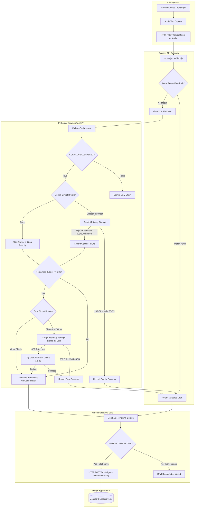
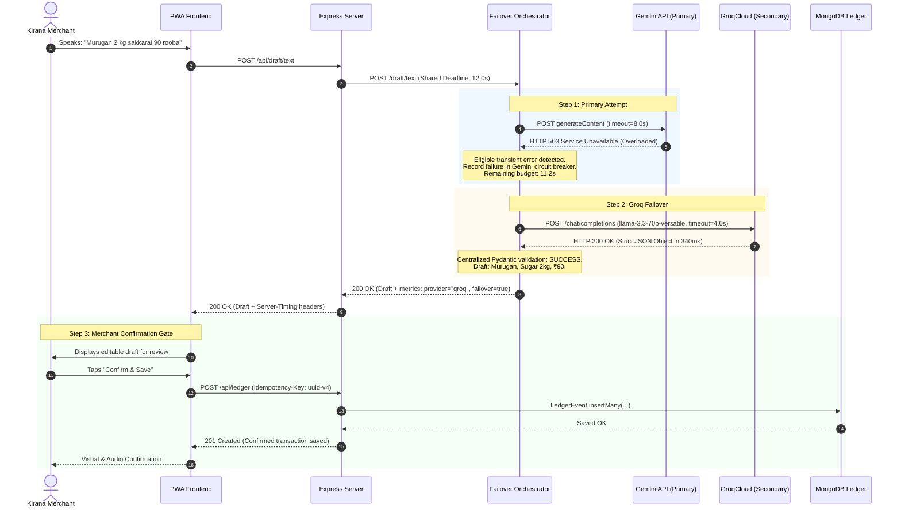
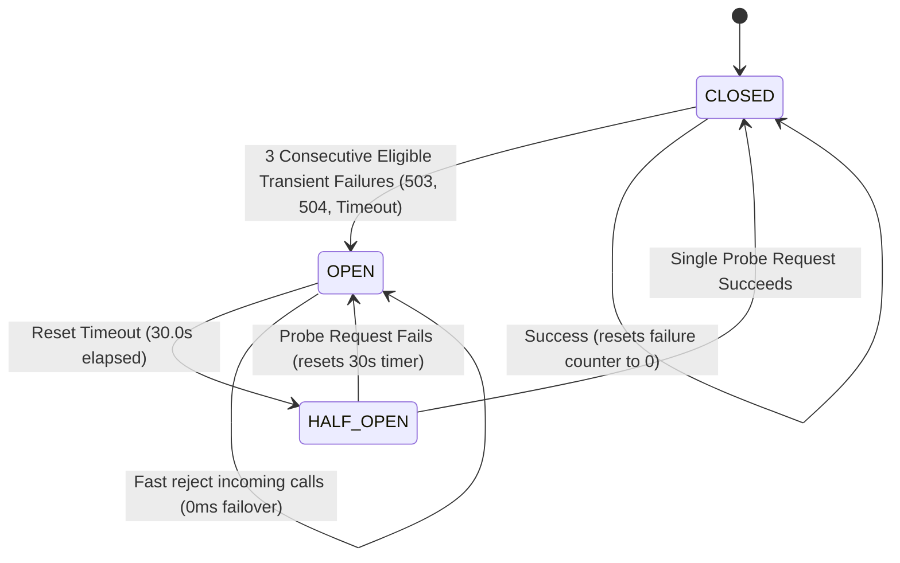

# 05 — Phase 2 Gemini Primary + Groq Secondary Failover Architecture

**Document:** `docs/05_PHASE2_FAILOVER_DESIGN.md`  
**Prepared by:** Senior AI Systems Architect & Backend Engineering Team  
**Date:** 2026-10-27  
**Scope:** Architectural specification, sequence flows, circuit breaker mechanics, and deadline budgeting for CredYazh  

---

## 1. Architectural Overview & Design Principles

CredYazh operates as a high-trust voice ledger for kirana merchants. The AI extraction pipeline converts spoken or typed Tamil, Tanglish, and English notes into structured, editable drafts.

To eliminate vulnerability to Gemini HTTP 503 high-demand errors while strictly preserving prototype stability, the Phase 2 architecture establishes an enterprise-grade **Primary/Secondary Failover Orchestrator**:

1. **Gemini remains the Primary AI Engine:** Native audio comprehension and proven Tamil reasoning.
2. **Groq acts as the Secondary AI Engine:** Ultra-low-latency LPU text inference invoked *only* on eligible transient failures.
3. **Sequential, Not Simultaneous:** No parallel calls by default, preventing wasteful token expenditure and API key rate exhaustion.
4. **Anti-Thrashing on Ambiguity:** Never switch providers if Gemini succeeds but returns ambiguous financial data (e.g. missing price). Semantic ambiguity is a merchant review concern, not a transport failure.
5. **Shared End-to-End Deadline:** Enforces a unified wall-clock budget (default 12,000 ms) partitioned across providers.
6. **Transcript-Preserving Manual Fallback:** If both providers fail or time out, the system outputs an unconfirmed draft with the merchant's original transcript intact, enabling seamless manual entry.
7. **Strict Confirmation Gate:** No AI output—whether from Gemini, Groq, or fallback—can ever persist to the database without explicit merchant review and confirmation via an idempotent HTTP POST.

---

## 2. System Architecture Diagram



---

## 3. End-to-End Sequence Diagram (Gemini 503 Failover)



---

## 4. Circuit Breaker State Machine

Each provider is encapsulated by a dedicated, thread-safe `CircuitBreaker`:



### Circuit Breaker Parameters
| Parameter | Default Value | Description |
|---|---|---|
| `failure_threshold` | `3` | Number of consecutive transient errors required to trip circuit open |
| `reset_timeout_s` | `30.0s` | Duration the circuit remains OPEN before probing recovery |
| `is_transient` filter | Strict whitelist | Only `503`, `502`, `504`, `429`, and network timeouts trip the breaker |

---

## 5. Shared End-to-End Deadline Budgeting

To ensure that failover never causes unacceptably long user-facing hangs, a **shared deadline budget** is partitioned dynamically across attempts:

$$\text{Budget}_{\text{total}} = 12,000 \text{ ms}$$

1. **Attempt 1 (Gemini Primary):**  
   Allocated $\min(\text{Remaining}, 8,000\text{ ms})$.
2. **Budget Verification:**  
   If Gemini fails after $\Delta t_1$, remaining budget is checked:
   $$\text{Budget}_{\text{remaining}} = \text{Budget}_{\text{total}} - \Delta t_1$$
   - If $\text{Budget}_{\text{remaining}} < 800\text{ ms}$: **Abort to manual fallback immediately**. (Avoids making a network call destined to time out).
3. **Attempt 2 (Groq Secondary):**  
   Allocated $\min(\text{Budget}_{\text{remaining}}, 4,000\text{ ms})$.
4. **Final Cutoff:**  
   If Groq also fails or times out, the orchestrator immediately constructs a **Transcript-Preserving Manual Fallback**.

---

## 6. Anti-Thrashing Policy: Handling Financial Ambiguity

A critical architectural mandate is preventing provider thrashing when an AI model correctly parses an incomplete note:

```python
# ANTI-THRASHING POLICY:
if resp.success and resp.draft is not None:
    # If the merchant only said: "Amudha akka took dal, will pay later"
    # Total is None and confidence is "low" or "medium".
    # This is a SEMANTIC ambiguity in the merchant's speech, NOT a system failure.
    # We DO NOT switch to Groq. We return the draft to the merchant review screen.
    return resp.draft
```

Switching to a second AI provider merely because a transaction lacks an amount is counter-productive; it burns quota, doubles latency, and risks hallucinating an amount that was never said.

---

## 7. Transcript-Preserving Manual Fallback

When all AI providers fail, time out, or have open circuit breakers, the user must never be presented with a dead screen or lost input.

The fallback mechanism guarantees:
1. `transcript`: Exact text or audio transcript is preserved.
2. `customer_name`: Pre-filled if extractable, otherwise empty for quick typing.
3. `confidence`: Marked `"low"`.
4. `metrics.manual_fallback_reason`: Records root cause (`BOTH_PROVIDERS_UNAVAILABLE`, `CIRCUIT_BREAKER_OPEN`, `DEADLINE_EXCEEDED`).
5. Merchant review interface opens directly, pre-populated with their spoken note.

---

## 8. Implementation Status Matrix

| Component | Status | Verification Evidence |
|---|---|---|
| **Multi-Provider Orchestrator (`failover_orchestrator.py`)** | **Implemented and tested** | Verified in `test_phase2_failover.py` |
| **Circuit Breakers (`CircuitBreaker`)** | **Implemented and tested** | State transitions verified in Test 6 |
| **Transient Error Classifier (`is_eligible_transient_error`)** | **Implemented and tested** | Whitelist filtering verified in Tests 2, 3, 5 |
| **Shared Deadline Budgeting** | **Implemented and tested** | Wall-clock limits verified in Test 4 |
| **Provider Concurrency Limiter (Semaphores)** | **Implemented and tested** | Concurrency bounds verified in Test 9 |
| **Transcript-Preserving Manual Fallback** | **Implemented and tested** | Utterance preservation verified in Tests 3, 5, 6 |
| **Anti-Thrashing on Ambiguity Policy** | **Implemented and tested** | No-switch invariant verified in Test 8 |
| **Merchant Confirmation Gate Invariant** | **Implemented and tested** | Stateless DTO verified in Tests 10, 11, 12 |
| **Production FastAPI Integration (`main.py`)** | **Implemented and tested** | Conditionally wired under `AI_FAILOVER_ENABLED=false` |
| **Live Groq Token Streaming** | **Proposed** | Text JSON output currently non-streamed; streaming proposed for Phase 3 |
| **Audio-to-Groq Direct Failover (Whisper STT pipe)** | **Proposed** | Groq LPU text is ready; audio pipeline pipe proposed for Phase 3 |
